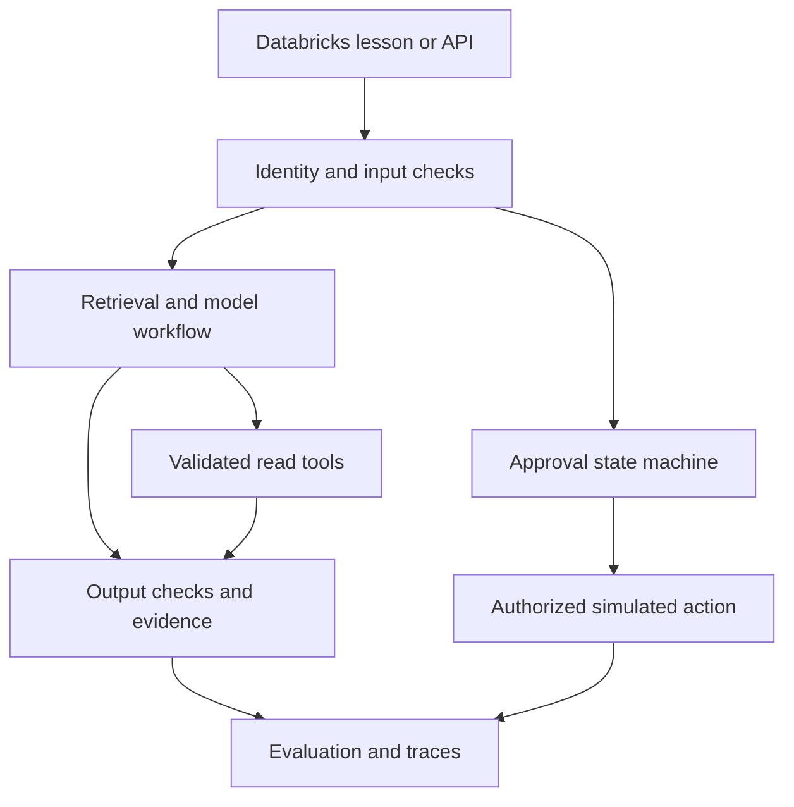

# Architecture and learning boundaries

The application separates environment configuration, provider communication, deterministic
business policy, workflow composition and user entry points. Each lab imports only what it needs.
Databricks source notebooks load secrets on the driver and run the same Python scripts used locally.

The synthetic user Alice owns ORD-1001; Bob owns ORD-1002. Trusted Principal objects stand in
for validated identity claims. They are not a production login service. Tool calls cannot select
another principal. Search returns only evidence scoped to the trusted tenant.

A model generates language and can propose tool calls. Code enforces tool allowlists, argument
shape, ownership, eligibility, approval expiry and idempotency. The ledger's effects are local
simulations; no real refund endpoint is present. Remote payment atomicity requires additional
backend guarantees beyond SQLite transactions.

Offline paths demonstrate algorithms, contracts or clearly labeled fixtures. Azure paths make
real service calls and fail visibly on errors. Portal-led exercises are marked as such because
they require tenant-specific resource/connection configuration. Industry-style structure does
not make the sample production-ready; the purpose is to make every design decision inspectable.
