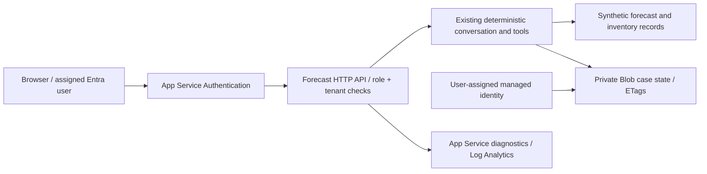

# Forecast RCA: Teams-independent Azure learning deployment

For a detailed step-by-step Portal/CLI route and troubleshooting, read [MANUAL_WALKTHROUGH.md](MANUAL_WALKTHROUGH.md). Actual attempted steps are recorded in [DEPLOYMENT_JOURNAL.md](DEPLOYMENT_JOURNAL.md).

Start with [SETUP_GUIDE.md](SETUP_GUIDE.md) for the parallel account, Entra and service setup route. This is the main forecast project requested for a 5–6 hour session. The sibling AI-103 academy supplies independent service exercises; it is not silently integrated into this API.

## What you deploy



The template creates a paid B1 Linux plan, Python 3.12 web app, a user-assigned managed identity, a private Blob container, scoped storage-account Blob data RBAC, single-tenant platform authentication, and Log Analytics diagnostics. Storage shared-key and public-blob access are disabled. No Teams, Databricks, model deployment, Key Vault, Search or Application Insights is created. Log Analytics has a 0.1 GB/day ingestion cap, which is not an overall spending cap and can interrupt log ingestion. B1 provisioned charges continue when the app stops.

The API always uses the explicit synthetic lab and rejects ENABLE_LLM=true. All assigned Forecast.User users may query all lab facts; case state remains owned by tenant + object ID. This is an industry-style learning deployment, not a production certification: private networking, enterprise per-user data scopes, live warehouse certification, workload load testing, backup/recovery testing, alerting, deployment promotion and availability design are separate release work. The original Bot/Teams deployment is unchanged and has its own release gates.

## Access prerequisites

Use Azure Cloud Shell Bash in the subscription that actually has the credit. Confirm offer expiry/timezone in Portal, supported region and B1 quota. You need resource creation and role-assignment permissions, plus the ability to create/configure an Entra application and assign its app role. Azure credits do not grant Teams licensing, tenant administration, service quota or Entra directory rights. Follow the setup guide for the single-tenant registration, redirect URI, Forecast.User role and secure client secret entry. No secret is a template parameter.

Your browser must sign in through `https://APP.azurewebsites.net/.auth/login/aad` after configuring the web redirect URI and the secret app setting `MICROSOFT_PROVIDER_AUTHENTICATION_SECRET`. Open `/` after sign-in. Users without Forecast.User are denied even after successful authentication. Do not expose the Gunicorn origin behind another proxy that allows callers to forge X-MS-CLIENT-PRINCIPAL. App Service's required authentication is the trusted JWT validation boundary. WEBSITE_INSTANCE_ID is only a local configuration guard; it does not cryptographically validate headers.

## Deploy in Cloud Shell

Azure-side validation and execution have not been performed in Codex. Use the feature branch below in your authenticated Cloud Shell session. Record the commit SHA with deployment evidence; main may not contain these changes until review and merge.

```bash
git clone --branch feat/forecast-azure-learning --single-branch https://github.com/souravsaha1605/agentic_poc.git agentic_poc-azure-learning
cd agentic_poc-azure-learning/forecast-intelligence-rca-agent-2
git rev-parse HEAD
```

For a private repository, use your approved GitHub authentication in Cloud Shell; Azure sign-in does not automatically grant private GitHub access. Do not embed tokens in clone URLs. The source ZIP remains an optional transfer fallback. CI/CD deployment with Azure OIDC is a future extension; this branch does not automatically deploy or provision Azure resources.

From `forecast-intelligence-rca-agent-2`:

```bash
# Replace non-secret IDs/names; choose a supported region rather than guessing.
export LEARNING_SUBSCRIPTION='YOUR_SUBSCRIPTION_ID'
export LEARNING_RG='rg-forecast-learning'
export LEARNING_REGION='YOUR_SUPPORTED_REGION'
export FORECAST_APP='YOUR_GLOBALLY_UNIQUE_APP_NAME'
export FORECAST_STORAGE='YOUR_UNIQUE_LOWERCASE_STORAGE_NAME'
export FORECAST_TENANT='YOUR_TENANT_ID'
export FORECAST_CLIENT='YOUR_APP_REGISTRATION_CLIENT_ID'
az account set --subscription "$LEARNING_SUBSCRIPTION"
az account show --query '{subscription:id,tenant:tenantId,state:state}' -o table
az group create --name "$LEARNING_RG" --location "$LEARNING_REGION"
az deployment group validate --resource-group "$LEARNING_RG" --template-file deployment/learning/azuredeploy.json --parameters appName="$FORECAST_APP" storageName="$FORECAST_STORAGE" location="$LEARNING_REGION" entraTenantId="$FORECAST_TENANT" entraClientId="$FORECAST_CLIENT"
az deployment group what-if --resource-group "$LEARNING_RG" --template-file deployment/learning/azuredeploy.json --parameters appName="$FORECAST_APP" storageName="$FORECAST_STORAGE" location="$LEARNING_REGION" entraTenantId="$FORECAST_TENANT" entraClientId="$FORECAST_CLIENT"
# Inspect what-if, service quotas and current pricing before creating resources.
az deployment group create --name forecast-web --resource-group "$LEARNING_RG" --template-file deployment/learning/azuredeploy.json --parameters appName="$FORECAST_APP" storageName="$FORECAST_STORAGE" location="$LEARNING_REGION" entraTenantId="$FORECAST_TENANT" entraClientId="$FORECAST_CLIENT"
python3 deployment/learning/build_package.py --output /tmp/forecast-learning.zip
az webapp deploy --resource-group "$LEARNING_RG" --name "$FORECAST_APP" --src-path /tmp/forecast-learning.zip --type zip
```

Enter the Entra client secret only through secure Portal app settings or a Key Vault reference configured separately. Never put secrets into commands, checked-in files or chat. If role assignment or a provider is denied, inspect that precise operation and your access; do not switch to shared storage keys or disable authentication to pass a demo.

## Functional acceptance after deployment

1. GET `/health` without login: 200 and `status=alive`. This is a liveness check only.
2. GET `/` and POST `/ask` without login: platform 401. Sign in using the explicit /.auth/login/aad route.
3. A signed-in user with no Forecast.User role: 403. Wrong tenant: denied by platform/adapter.
4. Assigned user opens `/`, asks `Analyze forecast performance for P0001 in North.` Expected synthetic accuracy 88.89%. Follow with `What about revenue?` Expected net revenue INR 12825.0.
5. Ask `What if demand is 15% higher?` Expected arithmetic scenario based on 1350 units, current 1552.5. This is not a prediction.
6. Restart your app with `az webapp restart --resource-group "$LEARNING_RG" --name "$FORECAST_APP"`, reopen the same browser and ask a follow-up. State should persist in Blob. A second identity cannot use the first identity's case/session.
7. For API replay, POST the same body twice with a stable session_id and request_id through an authenticated client; the second result must replay without another scenario version. Browser UI creates a fresh request per submission; do not use repeated clicks to test idempotency.
8. Inspect deployment logs, Log stream and actual Log Analytics records. A successful template deployment does not prove app startup, role propagation, Blob I/O or logs. RBAC can take time to propagate; inspect errors before retrying.

Browser console request (only on your signed-in app origin; IDs below are not secrets):

```javascript
const body = {session_id:'acceptance', request_id:crypto.randomUUID(), message:'Analyze forecast performance for P0001 in North.'};
const response = await fetch('/ask', {method:'POST', headers:{'Content-Type':'application/json'}, body:JSON.stringify(body)});
console.log(response.status, await response.json());
```

`/ready` requires authentication and checks core initialization. Only a successful `/ask`, follow-up and restart sequence verifies the useful storage workflow. Tokens and principal headers must never be copied to evidence or shell history.

## Local verification and scope

Use the prepared Python virtual environment or install the base requirements plus gunicorn and Azure SDKs from the deployment package requirements. From this component: `python app.py` runs the existing and new tests. Local HTTP tests use a simulated platform principal and SQLite temporary state; they do **not** validate Azure token validation or Blob connectivity. The actual deployed template chooses Blob state. See [VALIDATION.md](VALIDATION.md) for current evidence.

Before expiry, export the source package, ARM template, sanitized request results and screenshots. The setup guide includes dedicated-resource-group cleanup; inspect contents before deleting it. Exporting secrets or converting to pay-as-you-go is not required for this exercise.
